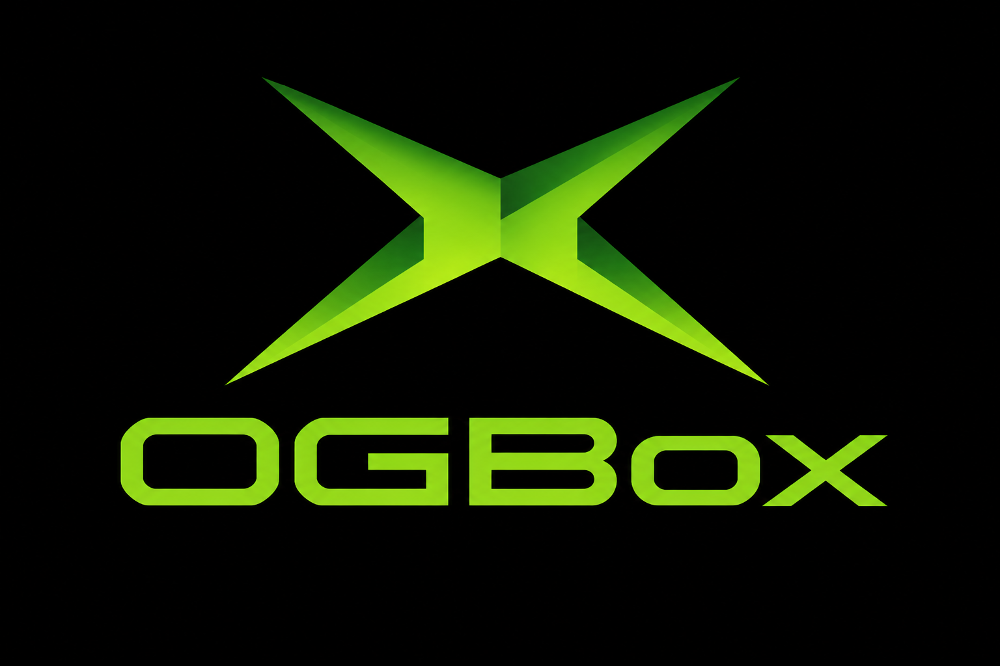

<p align="center">
  
</p>

# OGBox

**The original Xbox, on your PS5.** OGBox is an unofficial port of
[hakuX](https://github.com/rfandango/hakuX), an emulator for Microsoft's 2001 console, made into
a homebrew title (`PPSA99251`) for jailbroken PlayStation 5 consoles. It's made by Press5elect,
and it was called PSHakuX up to version 0.1.5.

**What's new in 1.0.1:**
- Settings > Xbox > Hard disk size: Automatic (the default) gives E: room again once it holds more
  than an Xbox's 4.9 GB.
- Stencil shadows that were missing in one game, and white streaks that crossed another's picture
  since the first public builds, are fixed.
- The kernel now has all 337 of the Xbox kernel's functions, and more of hakuX-lr's kernel, GPU and
  sound fixes are merged.

**Latest release: [v1.0.1](https://github.com/Press5elect/OGBox/releases/tag/v1.0.1).** Download
`OGBox-v1.0.1.zip` and copy it to your console. If you already have 0.0.2 or newer, you don't need
to: OGBox offers the update itself the next time it starts.

> **It's free, and it lives here only.** OGBox costs nothing and is only published on this
> GitHub page. If someone is asking you to pay for it, or offering it from somewhere else, that
> isn't this project.
>
> **No piracy, ever.** There are no games, Xbox BIOS, boot ROM, EEPROM, firmware or keys in this
> repository or in any release, and there never will be. Play backups of games you own, made
> yourself.
>
> **Please report problems here, not to hakuX.** OGBox is built on hakuX (by rfandango and
> contributors) and on xemu's sound chip emulation, but neither project makes or supports it.

## What to expect

This is **experimental** software. 1.0.1 is the tenth public release, after a long run of
bring-up builds (0.1.1 to 0.1.59). Some games boot and play well. Others won't start, stop
partway, slow down, or lose their graphics or sound. Crashes and in-game glitches can happen.

If you're curious how it works: the Xbox's own x86 code runs directly on the PS5's processor, in
its compatibility mode, instead of being translated. Calls into the Xbox kernel go through a gate
to the emulator's own kernel, the graphics are redrawn through the PS5's Vulkan driver (RADV), and the
sound comes out of the PS5's normal audio output.

When something goes wrong, the file `ogbox-boot.log` in the title folder says what happened (the
run before it is kept as `ogbox-boot.previous.log`). Please attach both when you open an issue.

## Getting started

1. **Install it.** Copy the `PPSA99251` folder from the ZIP to `/data/homebrew/` on the console.
2. **Bring your games.** OGBox reads disc images as `.iso` or `.xiso`, compressed `.cci` and `.cso`
   (the original Xbox's: Cerbios's and Stellar's), images split in parts (`game.1.iso`, `game.2.iso`,
   `game.1.cso`, `game.2.cso`), CHDs made with `chdman createdvd`, and extracted games: a folder with
   its `default.xbe` shows as the game, and any other `.xbe` starts with its folder as the disc. So one
   copy of your games serves both an original Xbox (CCI on Cerbios, CSO on Stellar, folders on any
   modded console) and OGBox. Put them wherever suits you:
   - on the console's storage, under `/data/`;
   - on a USB drive or extended storage;
   - on a computer or NAS on your network. In OGBox, open the **Network** tab and pick
     **Add a network share**. It can find SMB servers on your network for you, and NFS works too.

   With the payload loader (elfldr, port 9021) running, OGBox leaves the PS5's sandbox when it
   starts, so USB drives and extended storage show up. To keep it sandboxed, put an empty file
   named `elevation-off.txt` in the title folder.
3. **Start it** from the PS5 home screen. Press CROSS past the experimental notice. The first time,
   OGBox asks where to keep its data (the emulated Xbox hard disk, caches, covers and screenshots):
   the console's storage, a folder of your own, a USB drive or extended storage. A USB drive is
   recommended (OGBox lists it first): games write to the Xbox hard disk and the caches as they
   play, and the console slows a title's writes to its own storage down after a few GB, which slows
   the game; on a USB drive it doesn't. You can change it later in Settings > Data folder, and
   OGBox moves everything for you.
4. **Pick a game.** Your games show as covers, or as a list if you prefer (Settings > Game list).
   - **L1 / R1** switch between the **Internal**, **USB** and **Network** tabs.
   - The **D-pad** moves along your games. **UP** goes to the strip above them: the folders, the
     Xbox dashboard and adding a network share. **DOWN** comes back to the games.
   - **CROSS** opens a folder or starts a game, **SQUARE** starts it from the beginning, **CIRCLE**
     goes back.
   - **L2 / R2** jump a letter back or forward.
   - **TRIANGLE** opens a game's Game Details: its cover, description, Load State, settings,
     patches and saves.
   - **OPTIONS** opens Settings.
   - A USB keyboard works too.
5. **Play.** Press **OPTIONS** in a game for the **quick menu**. The game pauses and a panel slides
   in with Resume, Save state and Load state (10 slots, each with a picture of the moment), Where
   you left off, the game's settings and mods, Restart and Quit. Quit offers to save where you are,
   and the game offers to carry on from there next time.

### The controller

Your DualSense is an Xbox controller: CROSS is A, CIRCLE is B, SQUARE is X, TRIANGLE is Y, R1 is
Black and L1 is White, and L2 / R2 are the triggers. Click the left half of the touch pad for
Back and the right half for Start. OPTIONS is the quick menu for player 1 and Start for the other
players. If you'd rather have OPTIONS as Start, Settings > Interface > **Quick menu button** puts
the quick menu on a half-second hold instead. Each signed-in user's controller is a player (1 to 4),
and the menus show each face button in its Xbox colour (A green, B red, X blue, Y yellow).

**Settings > Controller** changes any of it: which DualSense button is each Xbox button, trigger,
D-pad direction, Start and Back, the sticks (swapped, or up and down turned over), and deadzones
for each stick and the triggers, for a worn stick that drifts. A game can have its own (its page >
Settings, or the quick menu), and a change applies at once, even in a game.

### Updates

OGBox checks GitHub for a newer release each time it starts (you can turn that off in
Settings > Interface), or when you choose **Updates** in Settings. It tells you what's new and
downloads nothing without asking. The download is checked against GitHub's SHA-256, then only
OGBox's own files are replaced. Your settings, the Xbox hard disk, save states, `boot.txt` and
games are left alone. OGBox then closes, ready to be started again, and if a power cut interrupts
an update, it's undone at the next start.

## Settings

Everything hakuX can change, and OGBox's own options, sorted into sections. The box under the list
explains whatever you've highlighted, and shows its default. CROSS picks the next choice, SQUARE the
one before.

**The defaults are the Xbox's own picture and sound.** Anything that changes the look (higher
resolution, anti-aliasing, sharpening and so on) is off until you turn it on.

- **Graphics:** resolution scale (up to 6x), anti-aliasing (FXAA, SMAA or SSAA), aspect ratio, the
  upscaling filter, anisotropic filtering, sharpening, forced 32-bit colour, 16-bit dithering,
  exact depth, cropping the overscan, HD texture packs and texture dumps.
- **Performance:** running the GPU on its own cores, frame pacing, an uncapped frame rate,
  compiling shaders in the background, and building cached shaders at start.
- **Audio:** sound mixing (Default: the game's own sound program mixes, as on the console; Fast:
  OGBox mixes the voices itself) and the resampler (Normal, Sinc or Linear).
- **Console:** language, memory (64 MB, or the 128 MB upgrade some patches need; Auto picks it
  when such a patch is on), Fast disc drive, the clock and the hard disk's size.
- **Video modes:** screen format, 480p, 720p, 1080i, PAL 60 and the video cable.
- **Network:** off, LAN, XLink Kai or Insignia.
- **Game list:** which places show, covers, layout (list or a grid of covers), names, sort order,
  and disc sizes.
- **Interface:** the theme (Dark, or Code with its falling green code), the FPS counter, checking
  for updates at start, and the quick menu button.

Any game can have its own Graphics, Performance, Audio, Console and Video settings: open its page
and choose **Game settings** (TRIANGLE puts one back to the app's). Settings are kept in
`/data/ogbox/settings.txt`, and each game's in `/data/ogbox/games/<title ID>.<version>.txt`. The
network addresses are typed there by hand (`lan_peers=`, `kai_engine=`, `insignia_dns=`).

## More to explore

**Covers and descriptions.** OGBox finds each game's cover on libretro's thumbnails first (by the
disc's Redump name, or its title ID), then MobCat's box scans, and finally the picture inside the
disc itself. A whole folder's covers download in one go, with a progress bar, and are kept in the
data folder's `covers`, named after the game's file (`Halo 2 (USA).iso` gets `Halo 2 (USA).png` or
`.jpg`). Want a different cover? Put your own picture there under the game's file name: it wins
over every download, and OGBox never deletes it. Game descriptions come from Wikipedia. You can
turn downloads off in Settings > Game list.

**Mods, patches and cheats.** A game's page lists what's available for it:
- hakuX's mods (60 and 120 fps mods, game fixes) and OGBox's own;
- XBE patches for widescreen, 60 fps and video modes, gathered from Jay's PatchHub and GitHub
  collection, icup321's XboxGraphicalPatches and OgXHD, all off by default;
- cheats.

Everything is checked against your exact release of the game first. One made for a different
release is greyed out, so it can't be turned on by mistake. **Game fixes** are mods a game needs
to run properly: they're always on and shown greyed out, so you can see what's applied.
`ps5/mods/README.md` explains how to write your own.

**HD texture packs.** OGBox can replace a game's textures with your own. Turn on **Dump textures**
(Settings > Picture > Textures, for one game) and play: each texture the game uses is saved once
into the data folder's `textures/<title ID>/dump`, compressed ones as DDS and the rest as PNG,
named `tex_<16-digit code>_<width>x<height>_<format>`. Edit or upscale a file to 1 to 8 times its
size (2x, 4x, 8x), keep `tex_<code>` in its name, and put it in `textures/<title ID>` (any
subfolder but `dump`): with **HD texture packs** on (the default) it replaces that texture. PNG
packs go up to 2048 x 2048; DXT1, DXT3 and DXT5 DDS files can be larger. The log says how many
replacements it found and why any was refused. [`docs/texture-packs.md`](docs/texture-packs.md)
has the details.

**Trainers.** OGBox runs the Xbox's `.etm` and `.xbtf` trainers, the way Evolution-X and
XBMC4Xbox did. It doesn't come with any: copy yours into the data folder's `trainers` folder,
`/data/ogbox/trainers`, or a USB drive's `OGBox/trainers`. Each game lists the trainers made for
it; ones made for another release are greyed out. Pick one, set its options, and they apply as the
game starts. Options marked IGK can also be switched in the game with the controller, just like on
the Xbox.

**The Xbox hard disk.** The hard disk manager (on the left, and in Settings) lists every game with
saves, newest first, and each save by name, date and size. You can copy saves out, move them,
delete them, or bring them back in from the data folder's `backups/saves` or a USB drive's
`OGBox/saves`. **Empty the cache drives** clears X:, Y: and Z:, which games simply fill again.

**Saves in sync between consoles.** In the hard disk manager, **Keep saves in sync with...** picks a
network share (or a USB drive). From then on your saves are kept the same both ways with
`OGBox/Saves/UDATA` there: when OGBox starts, after each game, and with **Sync now**. Every PS5 that
syncs with the same share has the same saves, as Crux2 does with its memory cards. The folder is
laid out like the Xbox's own `E:\UDATA`, so an Xbox or another emulator can take saves from it. A
save changed on both sides keeps the newer one, and the other goes to `OGBox/Saves/.older` (on the
console, the data folder's `backups/older saves`), so nothing is lost. A save deleted on one side
only comes back from the other, so while the saves are kept in sync, **Delete** in the hard disk
manager asks whether to delete it **here and on** the share too (or only here). **Saves on
<share>...** lists the saves on the share by game, those of other consoles too, and deletes a save,
or all of a game's, there (and on this console when it has it as well), so the next sync doesn't
bring it back. Deleting can't be undone; another PS5 syncing with the same share still has its own
copy and sends it back, so delete it there too. Settings > Network turns the sync on or off.

**The Xbox dashboard.** OGBox doesn't include it, but if your emulated hard disk has `xboxdash.xbe`
on its C: drive (`hdd/Partition2` in the data folder), an **Xbox dashboard** entry appears on the
left.

**`boot.txt`** (copy `boot.example.txt`) holds hakuX options (`scale=2`, `uncap`, ...) for every
game, on top of the settings. If its first line names a disc image and it has an `autoboot` line,
that game starts straight away, skipping the list.

**Where your data lives.** The Xbox hard disk is in the data folder's `hdd`, save states in
`states` and shader caches in `cache` (the data folder is `/data/ogbox` unless you chose another).
All of it sits outside the title folder, so updating is just replacing that folder. If you're
coming from 0.1.5 or older, the first start renames the old `/data/pshakux` for you.

One quirk: hakuX can't yet stop a game and start another in the same run, so starting a new game
or loading a state restarts the title with arguments (`--boot <image>`, `--loadstate <file>`,
`--relaunch`, `--hdd <folder>`, `--option <opt>`). A game that switches to another of its own XBEs
restarts the same way, keeping its last frame on screen meanwhile.

## Building it yourself

You'll need **LLVM 20's clang** (clang 18 can't link RADV's weak imports) and my PS5 stack checked
out next to this repository:
- `PS5_Vulkan`: the RADV archive, the link recipe, the native tool and `libc.prx`;
- `PS5_PayloadSDK`: the SDK fork, pinned;
- `PS5_Mesa`, only if you want to rebuild the RADV archive.

```bash
PS5_CLANG=/usr/lib/llvm-20/bin/clang bash ps5/tools/build.sh       # dist/PPSA99251/
PS5_CLANG=/usr/lib/llvm-20/bin/clang HAKUX_SRC=<a hakuX tree> bash ps5/tools/build.sh
                                                    # hakuX from a work tree instead
python3 ps5/tools/stage-notices.py --check dist/PPSA99251   # the release check
tests/run-pc-tests.sh --fetch                       # every PC test (patches, images, shares,
                                                    # updater, menus); CI runs it on each push
ps5/tools/deploy.sh                                 # upload over the console's FTP server
```

hakuX's source isn't kept here. `ps5/tools/fetch-hakux.sh` fetches it at the pinned revision into
`vendor/hakuX`, and `ps5/tools/prepare-hakux.sh` copies it (or the tree `HAKUX_SRC` names) into
`build/hakux-src` and applies `ps5/patches/hakux/ps5.patch` on top. That one patch is every change
OGBox makes to hakuX: the native CPU backend, save states, trainers, CHD images, the PS5
adaptations, and the work merged from hakuX-lr. Its header lists the commits it was made from,
with their authors. So this repository at a release's tag, plus hakuX at the pin, is that
release's complete source.

What the PS5 needs in place of hakuX's Android parts lives in `ps5/hakux/`:

| hakuX on Android | OGBox on the PS5 |
| --- | --- |
| FEXCore (the guest CPU, `native/cpu/cpu.cpp`) | the native backend (`native/cpu/cpu_native.c`, `NC_CPU=native`), a weak stub until it is there (`ps5/hakux/cpu/cpu_stub.c`) |
| AAudio (`native/dev/apu/out.c`) | `sceAudioOut`, 48 kHz, 256-sample blocking writes (`ps5/hakux/apu/out_ps5.c`) |
| the activity's window and its swapchain (`hw/xbox/hle/vk/swapchain.c`) | a host-owned image: the front frame handed to the title, which draws it on its own display (`ps5/hakux/hle/present_host.c`) |
| AHardwareBuffer guest RAM (zero copy) | hakuX's own copy fallback |
| system properties, prctl, eventfd, gettid, memfd | `ps5/hakux/compat` (properties from `boot.txt` and `props.txt`; memfd through the platform layer) |
| SDL3, JNI, the app (`native/app`) | OGBox's front end, `ps5/src/ogbox_main.cpp`, on the Core seam (`ps5/src/core/ogbox_core.h`) |

The front end talks to the emulator only through the Core (`ps5/src/core/ogbox_core.h`).

## Credits

The source history of OGBox's own PS5 work, and the attribution it requires, are in
[`PROVENANCE.md`](PROVENANCE.md). The legal terms are in [`NOTICE`](NOTICE).


- **hakuX** by rfandango and its contributors (GPL-3.0-or-later): the emulator. Its MCPX APU is
  xemu's (LGPL-2.1-or-later), with Hatari's DSP56300 emulation (GPL-2.0-or-later); its kernel
  export table is nxdk's (CC0). The voice processor's measured behaviour is from raddad772's
  tests on a retail console (xemu pull request #3105, LGPL-2.1-or-later), by way of
  CallistoNTG's hakuX port.
- **OGBox's logo** (the green X and the name) by Press5elect: `ps5/art/ogbox-logo.png`, the
  title's icon and launcher pictures (`ps5/tools/make-title-art.py`) and the start screen.
- **Crux2** and **Kelvin** by Press5elect: the console platform code (the boot log, the crash
  report, the clock, the thread priorities, the virtual file layer), the build and release tools,
  and the high-base link.
- **PS5 Vulkan Template, PS5_Vulkan, PS5_Mesa and the payload SDK fork** by Mihawk: the
  foundation, RADV on the console and the platform layer.
- **Crux2's frame generation** (Press5elect; GPL-3.0-or-later), with **AMD FidelityFX** (FSR 3 optical
  flow; MIT), **MihawkGen** (Mihawk; GPL-3.0-or-later) and NVIDIA Image Scaling (MIT, carried in the
  compute passes but not used by OGBox): Settings > Frame generation.
- **hakuX-lr** (PortareOS and its contributors; GPL-3.0-or-later): graphics, audio, disc and kernel
  improvements taken into the core.
- **xbased** (crazyriddler's hakuX fork, by way of Prodigy488's xbased-modern-gui; GPL-3.0-or-later):
  CPU, GPU and kernel fixes taken into the core.
- The hakuX contributors whose open pull requests to hakuX were taken in: Jbbrack03, Robby Czesany
  and Möhle Jonas. **Cxbx-Reloaded's xbox_kernel_test_suite** (the Cxbx-Reloaded team; GPL-2.0)
  measured the kernel against a console: no code of it is in OGBox.
- **libchdr** (Romain Tisserand; BSD-3-Clause), with the LZMA SDK, zstd and dr_flac: CHD images.
- **SMAA** (Jorge Jimenez, Jose I. Echevarria, Belen Masia, Fernando Navarro, Diego Gutierrez; MIT):
  the SMAA anti-aliasing shader and its area and search textures.
- **XBMC4Xbox** (Team XBMC, from team xored; GPL-2.0-or-later): the trainers' formats and the
  loader's functions that trainers call (hakuX-native's `native/core/trainer.c`).
- curl, OpenSSL, libpsl, libzip, RapidJSON and Mozilla's certificate list (as certifi carries it):
  the updater, as Crux2 has it.
- libslirp, nv2a_vsh_cpu, xxHash, glslang, volk, Dear ImGui, libktx, tinygltf, GLM, libsmb2,
  libnfs, zlib, Mesa, LLVM's runtime: every part, its authors and its licence are in
  `ps5/notices/components.json`, and in `licenses/README.txt` in the title folder.

## Licence

OGBox is GPL-3.0-or-later (`LICENSE`). Press5elect's own code carries an attribution term
under the GPL's section 7(b): keep "OGBox by Press5elect" (and "Crux2 by Press5elect" or
"Kelvin by Press5elect" for the files made from those projects) in the source notices and the
legal notices of any work based on it, however it is made, with AI tools included. The term
covers Press5elect's code and logo only, not hakuX's or xemu's. `NOTICE` has it in full.

"Xbox" is a trademark of Microsoft Corporation; "PlayStation", "PS5" and "DualSense" are
trademarks of Sony Interactive Entertainment. This project is not affiliated with either.

## Release notes and history

- [`docs/releases/`](docs/releases/README.md): the notes of every release, and a short
  [changelog](docs/releases/CHANGELOG.md).
- [`docs/history/bring-up.md`](docs/history/bring-up.md): the builds before the first release
  (0.1.0 to 0.1.59), and why the port is built the way it is.
- [`docs/README.md`](docs/README.md): the index of all the documentation, for users and for
  people (and agents) working on OGBox.
